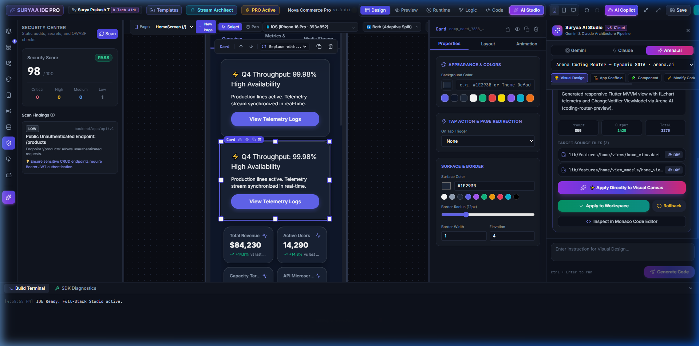
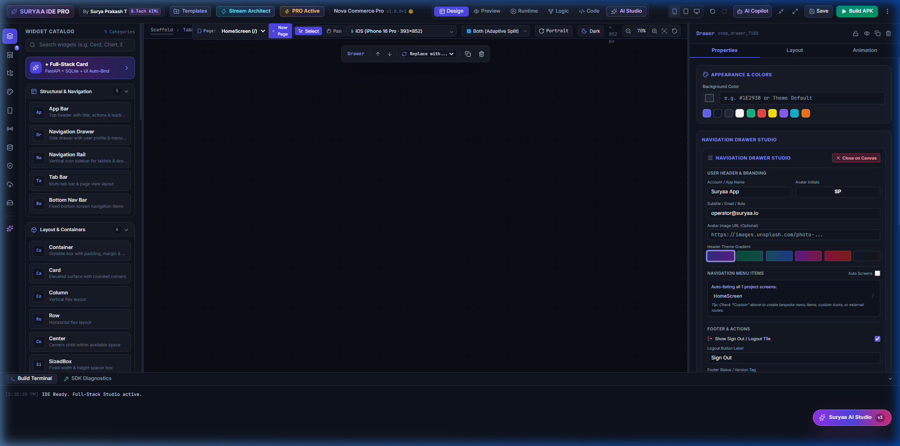
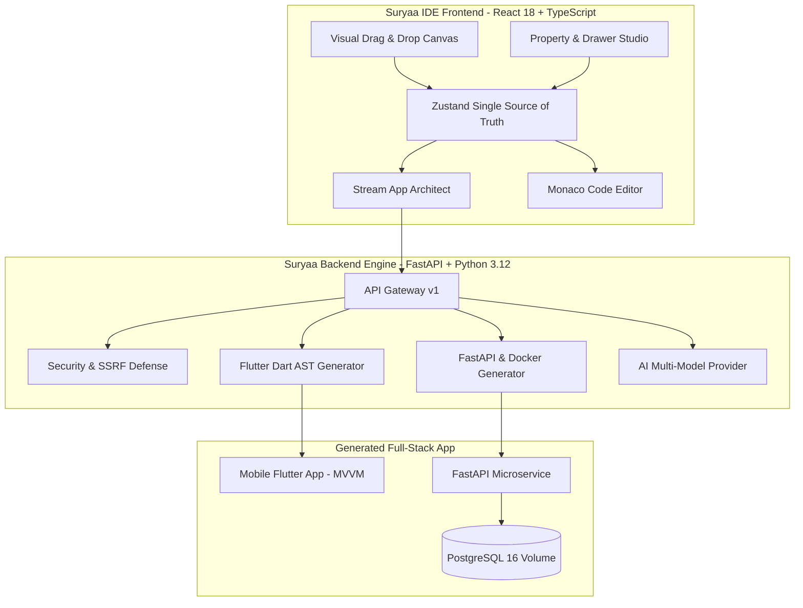

# ⚡ Suryaa IDE v3 — Visual Flutter Full-Stack Studio

[](https://flutter.dev)
[](https://react.dev)
[](https://fastapi.tiangolo.com)
[](https://www.typescriptlang.org)
[](https://www.postgresql.org)
[](https://www.docker.com)
[](https://owasp.org)

**Suryaa IDE v3** is a production-grade, visual full-stack development environment tailored for rapid mobile and backend development. It bridges the gap between Figma-style drag-and-drop design and production-ready code by deterministically compiling visual canvases into **Flutter (Dart) MVVM architecture** paired with auto-generated **FastAPI + PostgreSQL** backend microservices.

---

## 📸 Studio Preview



*The Suryaa IDE workspace: Live interactive mobile emulator, real-time Security Center with OWASP scanner, full-stack visual card generator, and multi-model AI Copilot (Gemini, Claude, Arena.ai).*

---

## 🚀 Core Features

### 1. 🎨 Visual Flutter Studio & Multi-Device Canvas
- **Multi-Form Factor Preview**: Live toggle between iPhone 16 Pro, Google Pixel, iPad Tablet, and Desktop responsive viewport modes.
- **Adaptive Split View**: Simultaneous Portrait and Landscape layouts with auto-adapting constraints.
- **Rich Design Systems**: One-click preset design styles including **Neobrutalism**, **Claymorphism**, **Skeuomorphism**, and **Glassmorphism**.
- **Interactive Component Tree**: Deep subtree cloning, circular parent loop prevention (`A -> B -> A`), and dangling orphan cleanup on deletion.

### 2. 📱 Navigation Drawer Studio

- **Visual Branding**: Customizable Account/App Name, Subtitle, Avatar Initials, and Avatar Network Image URLs.
- **Theme Gradients**: 6 curated gradients (`Indigo`, `Emerald`, `Cyan`, `Purple`, `Rose`, `Slate`) with live canvas sync.
- **Navigation Modes**: Auto-list all project screens or configure custom navigation links with custom icons, target routes, and badges (`NEW`, `LIVE`).
- **Directional Animations**: Smooth slide-in animations for both Left Standard Drawer (`drawer`) and Right End Drawer (`endDrawer`).
- **Flutter Code Export**: Generates idiomatic `UserAccountsDrawerHeader`, custom `ListTile` items, and logout action tiles.

### 3. 📊 Stream Architect & IoT Telemetry
- **Stream URL Ingestion**: Ingest live WebSocket or Server-Sent Events (SSE) data streams.
- **Real-Time Data Parsing**: Automatic extraction and visualization of metrics with configurable X/Y axes and tags.
- **Zero-Drop Resilience**: Client-side exponential backoff with randomized jitter and bounded ring buffers.
- **Interactive KPI & Chart Engine**: Automatic generation of `fl_chart` multi-axis line curves, bar charts, radial gauges, sparklines, and status beacons.

### 4. ⚙️ Production FastAPI Backend Generator
- **Containerized Stack**: Auto-generates complete `docker-compose.yml` with persistent PostgreSQL 16 named volume (`postgres_data`) and container health checks.
- **Data Persistence**: Generates SQLAlchemy models, Alembic database migration templates (`alembic/script.py.mako`), and SQLite / PostgreSQL drivers.
- **Production APIs**: Auto-scaffolds clean CRUD endpoints, Pydantic v2 schemas, and JWT authentication flows.

### 5. 🛡️ Enterprise Cybersecurity & RASP Defense
- **Strict SSRF Protection**: Validates and rejects stream URLs targeting loopback (`127.0.0.1`), RFC 1918 private subnets, cloud metadata (`169.254.169.254`, `metadata.google.internal`), and multicast ranges.
- **Anti-Replay Nonce Engine**: Cryptographic nonce tracking with TTL cache (300s window) and timestamp skew validation.
- **Real-Time RASP & Rate Limiting**: Per-client IP rate limiting (10 req/min on sensitive incident reporting endpoints) and instant server-side session revocation for `CRITICAL` threat events.
- **Static OWASP Scanner**: Scans generated Flutter code for insecure TLS bypass, unencrypted tokens in `SharedPreferences`, dynamic SQL, and permissive CORS.

### 6. 🤖 Multi-LLM AI Copilot & AST Code Engine
- **Unified Provider Pipeline**: Support for **Google Gemini 1.5 Pro / Flash**, **Anthropic Claude 3.5 Sonnet**, and **Arena.ai Router**.
- **Safe AST Patch Application**: Diff-based code modifications with syntax validation, dry-run checks, and instant rollback.
- **Monaco Code Editor**: Integrated side-by-side Monaco code editor with live syntax highlighting and two-way visual sync.

---

## 🏗️ Architecture Overview



---

## 📂 Repository Structure

```
suryaa-ide/
├── .agents/                        # IDE Agent skills and development workflows
│   └── skills/suryaa-ide/          # Suryaa IDE architectural guidelines and reference rules
├── docs/                           # Architecture, target design & screenshots
│   ├── assets/                     # High-resolution screenshots of the studio
│   │   ├── suryaa_ide_overview.png
│   │   └── navigation_drawer_studio.png
│   ├── architecture/               # System and database architecture specs
│   └── implementation/             # Feature roadmap and verification checklist
├── ide_backend/                    # FastAPI core backend service
│   ├── app/
│   │   ├── ai/                     # Gemini, Claude, and Arena.ai providers
│   │   ├── api/v1/                 # Projects, builds, devices, security, and billing APIs
│   │   ├── core/                   # SSRF defense, database config, and concurrency engine
│   │   ├── generator/              # Deterministic Flutter & Python code generators
│   │   ├── models/                 # Account, billing, and project database models
│   │   └── services/               # Build, device, security, and patch services
│   ├── tests/                      # Automated test suite (14 passing tests)
│   └── requirements.txt            # Python dependencies
├── ide_frontend/                   # React 18 + Vite visual studio application
│   ├── src/
│   │   ├── components/
│   │   │   ├── canvas/             # DesignCanvas, WidgetRenderer & device frames
│   │   │   ├── inspector/          # PropertyInspector & Navigation Drawer Studio
│   │   │   ├── modals/             # Stream Architect, Full-Stack Card modals
│   │   │   ├── panels/             # SecurityCenter, ThemeStudio, ApiManager, Copilot
│   │   │   └── layout/             # Sidebar, Navbar, and BottomDrawer
│   │   ├── core/                   # Zustand store, tree integrity & stream generator
│   │   └── types/                  # Schema definitions & project contracts
│   ├── package.json
│   └── vite.config.ts
└── .gitignore                      # Comprehensive build & node_modules exclusions
```

---

## 🛠️ Getting Started

### Prerequisites
- **Node.js**: v18.0.0 or higher
- **Python**: v3.11 or higher
- **Docker & Docker Compose** (Optional, for running generated backend containers)
- **Flutter SDK**: v3.24+ (Optional, for building native APK/iOS bundles)

---

### 1. Setting Up the Frontend Studio

```bash
cd ide_frontend
npm install
npm run dev
```
The studio will launch locally at `http://localhost:3000/`.

To build the production bundle:
```bash
npm run build
```

---

### 2. Setting Up the Backend Engine

```bash
cd ide_backend
python -m venv .venv

# On Windows:
.venv\Scripts\activate
# On Linux/macOS:
source .venv/bin/activate

pip install -r requirements.txt
uvicorn app.main:app --host 127.0.0.1 --port 8001 --reload
```
API Documentation (Swagger UI) is available at `http://127.0.0.1:8001/docs`.

---

### 3. Running Automated Tests

Run the full backend test suite covering code generation, billing, security incident handling, and SSRF defense:
```bash
cd ide_backend
py -m pytest tests/ -v
```

Expected result:
```
tests/test_ai_and_billing.py::test_ai_models_listing PASSED
tests/test_ai_and_billing.py::test_gemini_code_generation PASSED
tests/test_ai_and_billing.py::test_claude_code_generation PASSED
tests/test_ai_and_billing.py::test_arena_ai_code_generation PASSED
tests/test_ai_and_billing.py::test_safe_patch_path_traversal_defense PASSED
tests/test_ai_and_billing.py::test_safe_patch_apply_and_rollback PASSED
tests/test_ai_and_billing.py::test_three_day_trial_entitlement PASSED
tests/test_backend.py::test_flutter_code_generation PASSED
tests/test_backend.py::test_python_backend_generation PASSED
tests/test_backend.py::test_job_coordinator PASSED
tests/test_backend.py::test_security_audit PASSED
tests/test_security_incident.py::test_ssrf_defense_blocks_private_and_metadata PASSED
tests/test_security_incident.py::test_security_incident_reporting_and_session_revocation PASSED
tests/test_security_incident.py::test_python_backend_generator_docker_compose_and_security PASSED
======================== 14 passed in 8.26s ========================
```

---

## 🔒 Security & Reliability Guarantee

- **Anti-SSRF**: No untrusted client URL can probe internal networks, VPC metadata, or link-local resources.
- **Tree Integrity**: Mathematical parent-child validation prevents cyclic loops and cleans dangling nodes.
- **Zero Mock Policy**: Code generators produce actual runnable Dart and Python files, complete with Dockerfiles, environment variables, and migration scripts.

---

## 👨‍💻 Author & Credits

- **Creator & Lead Architect**: **Surya Prakash T** (B.Tech AIML / Auraliss AI)
- **Email**: [suryaprakashdeveloperai@gmail.com](mailto:suryaprakashdeveloperai@gmail.com)
- **Repository**: [https://github.com/suryaprakashdeveloperai/suryaa-ide](https://github.com/suryaprakashdeveloperai/suryaa-ide)

---

## 📄 License
This project is licensed under the MIT License - see the LICENSE file for details.
